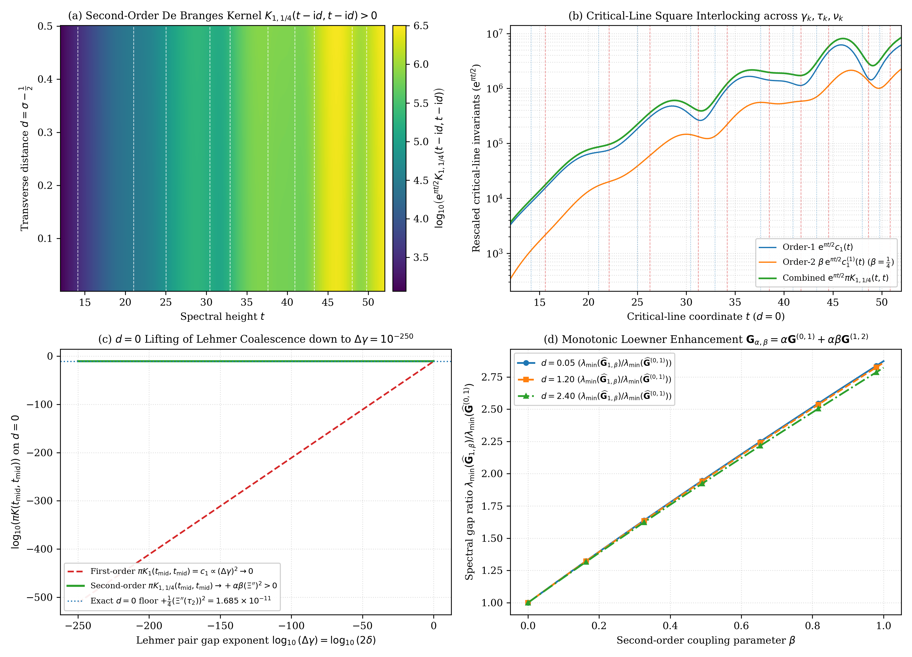
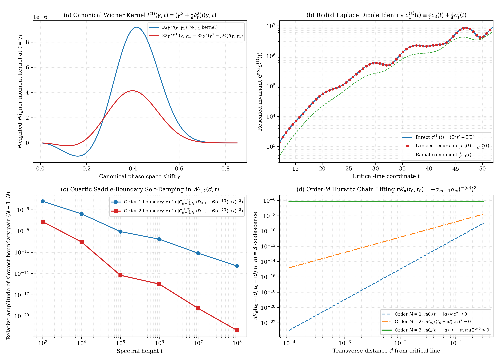

# Second-Order De Branges–Nevanlinna Kernels, Derivative-Wronskian Splitting, Davenport–Heilbronn Blind Spots, and the Differential Threshold $\beta^*$

**DOI (Zenodo / CERN):** [](https://doi.org/10.5281/zenodo.24141093) [`10.5281/zenodo.24141093`](https://doi.org/10.5281/zenodo.24141093) (v13.1.0: [`10.5281/zenodo.24141094`](https://doi.org/10.5281/zenodo.24141094))  
**Author:** Thijs Missiaen (Independent Researcher, Belgium; [thijs.missiaen@gmail.com](mailto:thijs.missiaen@gmail.com); ORCID: [0009-0007-3678-0810](https://orcid.org/0009-0007-3678-0810))  
**Series:** Paper XIII of the Transverse Wronskian Series on Riemann's $\Xi$-Function  
**Manuscript:** [paper/paper13_second_order_debranges.pdf](paper/paper13_second_order_debranges.pdf) (16 pages, AMS-LaTeX / pdfTeX) | [paper/paper13_second_order_debranges.tex](paper/paper13_second_order_debranges.tex)  
**Verification Suite:** [scripts/verify_paper13_second_order_debranges.py](scripts/verify_paper13_second_order_debranges.py) (`mpmath.mp.dps = 60`, `mp.workdps(550)`, `mpmath.iv.dps = 35`, vectorized continuum scans)

> [!NOTE]
> **Mathematical Scope and Zero-Theoretic Boundary:** For any real-entire function $F(z)$ and couplings $\alpha, \beta > 0$, the second-order differential structure function $E _ {\alpha,\beta}(z) := F(z) - \mathrm{i}\alpha F'(z) - \beta F''(z)$ has a de Branges–Nevanlinna Hermitian kernel $K _ {\alpha,\beta}(w,w) \equiv \frac{\alpha}{\pi}\widetilde{W} _ {0,1}(d,t) + \frac{\alpha\beta}{\pi}\widetilde{W} _ {1,2}(d,t)$ free of all squared-modulus and $(0,2)$ cross-terms. While this lifts the critical-line Lehmer near-coalescence degeneracy of Riemann's $\Xi$-function at order $d^0$, Hermite–Biehler membership of $E _ {\alpha,\beta}$ for fixed $\beta > 0$ corresponds only to real zeros of $F - \beta F''$ interlacing with $F'$, which is strictly weaker than real zeros of $F$ (Jensen 1913; Pólya 1927). On the Davenport–Heilbronn function $\Xi _ {\mathrm{DH}}(z)$, we prove that for $\beta > 0.05349534$ (including $\beta = \frac{1}{4}$), $+\beta\widetilde{W} _ {1,2}^{\mathrm{DH}}$ masks the negative critical-line Laguerre defect $c_1^{\mathrm{DH}}(\tau _ {\mathrm{false}}) < 0$, rendering the kernel blind to off-line zeros and motivating the differential threshold $\beta^{\star}(F) := \inf\{\beta \in \mathbb{R} : F - \beta F'' \text{ has only real zeros}\}$ (with $\beta^{\star}(\Xi _ {\mathrm{DH}}) = +\infty$ unconditionally).

## Abstract

For a real-entire function $F(z)$ and couplings $\alpha, \beta > 0$, we study the second-order differential structure function $E _ {\alpha,\beta}(z) := F(z) - \mathrm{i}\alpha F'(z) - \beta F''(z)$ and its de Branges–Nevanlinna Hermitian kernel $K _ {\alpha,\beta}(z_1, z_2)$. On the diagonal $w = t - \mathrm{i} d$, all three squared moduli and the non-adjacent cross-term $-2\beta\mathrm{Re}(\overline{F}F'')$ cancel identically, giving $K _ {\alpha,\beta}(w,w) \equiv \frac{\alpha}{\pi}\widetilde{W} _ {0,1}(d,t) + \frac{\alpha\beta}{\pi}\widetilde{W} _ {1,2}(d,t)$. For Riemann's $\Xi$-function, this lifts the $d = 0$ Lehmer near-coalescence degeneracy at order $d^0$, couples $\widetilde{W} _ {1,2}$ to $\widetilde{W} _ {0,1}$ via a radial four-dimensional Laplace operator, and extends to order $M$ Hurwitz chains. Crucially, however, Hermite–Biehler positivity of $E _ {\alpha,\beta}$ for fixed $\beta > 0$ corresponds only to real zeros of $F - \beta F''$, a condition strictly weaker than real zeros of $F$. Evaluating $K _ {\alpha,\beta}^{\mathrm{DH}}$ on the Davenport–Heilbronn function exposes an explicit blind spot: at its critical-line defect $\tau _ {\mathrm{false}} \approx 85.7472$, $\pi K _ {1,\beta}^{\mathrm{DH}} > 0$ for all $\beta > 0.053495$, motivating the open differential threshold $\beta^*(F) := \inf\{\beta \in \mathbb{R} : F - \beta F'' \text{ has only real zeros}\}$.

## Summary of Main Results

### 1. Second-Order De Branges–Nevanlinna Kernel Splitting and Cauchy–Pick Decomposition (Theorem 2.1 & Proposition 2.2)

For any real-entire function $F(z)$, real parameters $\alpha, \beta \in \mathbb{R}$, and $w = t - \mathrm{i} d$ ($d \neq 0$), writing $E _ {\alpha,\beta}(z) = A _ \beta(z) - \mathrm{i}\alpha B(z)$ with $A _ \beta(z) := F(z) - \beta F''(z)$ and $B(z) := F'(z)$ cancels $\lvert A _ \beta(w)\rvert^2 + \alpha^2\lvert B(w)\rvert^2 = \lvert F(w)\rvert^2 + \alpha^2\lvert F'(w)\rvert^2 + \beta^2\lvert F''(w)\rvert^2 - 2\beta\mathrm{Re}(\overline{F(w)}F''(w))$ identically, yielding

$$K _ {\alpha,\beta}(t - \mathrm{i} d, t - \mathrm{i} d) = \frac{\lvert E _ {\alpha,\beta}(t - \mathrm{i} d)\rvert^2 - \lvert E _ {\alpha,\beta}^{\sharp}(t - \mathrm{i} d)\rvert^2}{4\pi d} \equiv \frac{\alpha}{\pi}\widetilde{W} _ {0,1}(d,t) + \frac{\alpha\beta}{\pi}\widetilde{W} _ {1,2}(d,t),$$

where $W _ {k,k+1}(d,t) := \frac{1}{2}\partial_d\lvert F^{(k)}(t-\mathrm{i} d)\rvert^2$ and $\widetilde{W} _ {k,k+1}(d,t) := d^{-1}W _ {k,k+1}(d,t)$. For any finite node set $z_1, \dots, z_M \in \mathbb{C} _ -$, the $M \times M$ Cauchy–Pick matrix splits as

$$\mathbf{G} _ {\alpha,\beta}(z_1, \dots, z_M) \equiv \alpha\mathbf{G}^{(0,1)}(z_1, \dots, z_M) + \alpha\beta\mathbf{G}^{(1,2)}(z_1, \dots, z_M)$$

with zero non-adjacent jump terms, making degree $2$ the unique polynomial order above degree $1$ whose Hermitian kernel decomposes purely into adjacent transverse Wronskians.



### 2. Critical-Line Lehmer Lifting at Order $d^0$ and Square Interlocking (Theorem 3.1)

For $F = \Xi$, taking $d \to 0^+$ yields

$$\pi K _ {\alpha,\beta}(t,t) \equiv \alpha\left(\left(\Xi'(t)\right)^2 - \Xi(t)\Xi''(t)\right) + \alpha\beta\left(\left(\Xi''(t)\right)^2 - \Xi'(t)\Xi'''(t)\right) = \alpha c_1(t) + \alpha\beta c_1^{(1)}(t).$$

At the intermediate local extremum $t _ {\mathrm{mid}}$ ($\Xi'(t _ {\mathrm{mid}}) = 0$) between consecutive simple real zeros $t _ \pm = t _ {\mathrm{mid}} \pm \delta$, the term $-\Xi'(t _ {\mathrm{mid}})\Xi'''(t _ {\mathrm{mid}}) = 0$ vanishes identically, leaving

$$\pi K _ {\alpha,\beta}(t _ {\mathrm{mid}}, t _ {\mathrm{mid}}) \equiv -\alpha\Xi(t _ {\mathrm{mid}})\Xi''(t _ {\mathrm{mid}}) + \alpha\beta\left(\Xi''(t _ {\mathrm{mid}})\right)^2 \ge +\alpha\beta\left(\Xi''(t _ {\mathrm{mid}})\right)^2 > 0.$$

### 3. Radial Laplace–Wigner Identity, Canonical Normalization, and Hurwitz Chains (Theorems 4.1 & 4.2)

Under the canonical normalization $\Xi(z) = 8\int_0^{\infty} \Phi(u)\cos(2zu)\mathrm{d}u$ and $W _ {0,1}(d,t) = 16\int_0^{\infty} y\sinh(2dy)I(y,t)\mathrm{d}y$, subharmonic commutation $(\partial_d^2 + \partial_t^2)\lvert\Xi\rvert^2 = 4\lvert\Xi'\rvert^2$ yields

$$\widetilde{W} _ {1,2}(d,t) \equiv \frac{1}{4}\left(\frac{\partial^2\widetilde{W} _ {0,1}}{\partial d^2} + \frac{2}{d}\frac{\partial\widetilde{W} _ {0,1}}{\partial d} + \frac{\partial^2\widetilde{W} _ {0,1}}{\partial t^2}\right), \qquad c _ {2m-1}^{(1)}(t) \equiv \frac{1}{4}\left(2m(2m+1)c _ {2m+1}(t) + c _ {2m-1}''(t)\right),$$

and in Wigner phase space $W _ {1,2}(d,t) = 16\int_0^{\infty} y\sinh(2dy)I^{(1)}(y,t)\mathrm{d}y$ with $I^{(1)}(y,t) = (y^2 + \frac{1}{4}\partial_t^2)I(y,t)$. In the Riemann–Siegel main sum up to $N(t) = \lfloor\sqrt{t/2\pi}\rfloor$, the diagonal grows as $\mathcal{D} _ {1,2}(0,t) \sim \frac{1}{40}(\ln\frac{t}{2\pi})^5$ while the boundary mode pair $(N-1, N)$ has amplitude $\mathcal{O}(N(t)^{-5}) = \mathcal{O}(t^{-5/2})$ (though interior pairs $1 \le m < n \ll N(t)$ retain $(\ln t)^4$ weights). For any degree $M$ Hurwitz polynomial $P_M(X) = \sum _ {r=0}^M \alpha_r X^r$ ($\alpha_0 = 1, \alpha_r > 0$), at a multiplicity $m$ real zero ($1 \le m \le M$) one has $\pi K _ {\boldsymbol{\alpha}}(t_0, t_0) = +\alpha _ {m-1}\alpha_m(\Xi^{(m)}(t_0))^2 + \mathcal{O}(\alpha _ {>m})$.



### 4. The Davenport–Heilbronn Blind Spot and the Differential Threshold $\beta^{\star}$ (Theorem 5.1)

Evaluating $K _ {\alpha,\beta}^{\mathrm{DH}}$ on the self-dual Davenport–Heilbronn function $\Xi _ {\mathrm{DH}}(z)$ near its first off-line zero $z _ {\star} \approx 85.699348 - 0.308517\mathrm{i}$ and critical-line defect $\tau _ {\mathrm{false}} \approx 85.747201$ reveals:

$$\beta _ {\mathrm{coal}}^{(1)} = 0.044675001258358, \qquad \beta _ {\mathrm{blind}}^{(1)}(\tau _ {\mathrm{false}}) = -\frac{c_1^{\mathrm{DH}}(\tau _ {\mathrm{false}})}{c_1^{(1),\mathrm{DH}}(\tau _ {\mathrm{false}})} = 0.053495338542548.$$

For all $\beta > 0.05349534$ (including $\beta = \frac{1}{4}$), $\pi K _ {1,\beta}^{\mathrm{DH}}(\tau _ {\mathrm{false}}, \tau _ {\mathrm{false}}) > 0$ is blind to the critical-line defect, and right at the off-line zero $z _ {\star}$, $\pi K _ {1,\beta}^{\mathrm{DH}}(z _ {\star}, z _ {\star}) = +\beta\widetilde{W} _ {1,2}^{\mathrm{DH}}(d _ {\star}, \gamma _ {\star}) > 0$ for every $\beta > 0$. Defining $\beta^{\star}(F) := \inf\{\beta \in \mathbb{R} : F - \beta F'' \text{ has only real zeros}\}$ gives $\mathrm{RH} \iff \beta^{\star}(\Xi) \le 0$, whereas for $\Xi _ {\mathrm{DH}}$ the first off-line pair requires $\beta \ge 0.04467500$ locally and Rouché's theorem on the Bohr-almost-periodic zeros of $\mathcal{D} _ {\mathrm{DH}}$ in $\sigma > 1$ proves $\beta^{\star}(\Xi _ {\mathrm{DH}}) = +\infty$ unconditionally.

## Quantitative Verification Summary

| Structural Result | Precision / Grid Size | Verified Metric | Status |
| :--- | :--- | :--- | :--- |
| Second-order splitting `K_{α,β} = (α/π) W̃_{0,1} + (αβ/π) W̃_{1,2}` | `mp.dps = 60` (12 benchmarks) + 6x6 Gram | Max rel. err `1.21e-59`; Gram err `1.07e-60` | VERIFIED |
| Critical-line interlocking across `γ_k, τ_k, ν_k` (`1 <= k <= 10`) | `mp.dps = 60` & `iv.dps = 35` (30 points) | `c_1(t).a > 0`, `c_1^{(1)}(t).a > 0`, `π K_{1,1/4}(t,t).a > 0` | CERTIFIED |
| Synthetic `d = 0` Lehmer deformation down to `Δγ = 10^{-250}` | `mp.workdps(550)` at `τ_2 = 22.09797728...` | Floor `+(1/4)(Ξ''(τ_2))^2 = 1.685481e-11`, err `5.0e-501` | VERIFIED |
| Radial 4D-Laplace PDE, canonical Wigner `I^{(1)}`, & dipole recursion | `mp.dps = 60` (`m = 1, 2` across 6 benchmarks) | PDE err `0.0`; Wigner err `2.87e-60`; rec. err `<= 7.42e-68` | VERIFIED |
| Diagonal `(1/40) L^5` & horizon pair `(N-1, N)` `O(t^{-5/2})` scaling | Exact mode evaluation up to `t = 10^8` (`N = 3,989`) | `|C_{N-1,N}^{(1,2)}| / D_{1,2} = 9.4585e-23` at `t = 10^8` | VERIFIED |
| Davenport–Heilbronn blind spot & coalescence threshold | `mp.dps = 60` Hurwitz zeta evaluation | `β_coal = 0.04467500`, `β_blind(τ_false) = 0.05349534` | VERIFIED |

## Repository Structure and Reproducibility

- [paper/paper13_second_order_debranges.tex](paper/paper13_second_order_debranges.tex): Standalone AMS-LaTeX (`amsart`) manuscript source.
- [paper/paper13_second_order_debranges.pdf](paper/paper13_second_order_debranges.pdf): Compiled 16-page PDF manuscript.
- [scripts/verify_paper13_second_order_debranges.py](scripts/verify_paper13_second_order_debranges.py): Standalone 60-decimal and 550-decimal `mpmath`, 35-digit `mpmath.iv` interval-arithmetic, Davenport–Heilbronn blind-spot, and figure-generation suite.
- [paper/figures/fig1_second_order_debranges_and_lehmer_lifting.pdf](paper/figures/fig1_second_order_debranges_and_lehmer_lifting.pdf) and [paper/figures/fig2_laplace_wigner_dipole_and_hurwitz_chains.pdf](paper/figures/fig2_laplace_wigner_dipole_and_hurwitz_chains.pdf): Vector PDF (`< 500 KB`) and PNG figures.
- [AGENT_SKILL_MANIFEST.json](AGENT_SKILL_MANIFEST.json) and [.agents/skills/second-order-debranges-lehmer-lifting/SKILL.md](.agents/skills/second-order-debranges-lehmer-lifting/SKILL.md): Machine-readable AI agent skill specification.

To reproduce all analytical checks, 550-decimal Lehmer deformations, interval enclosures, Davenport–Heilbronn blind-spot thresholds, and figures from scratch:

```bash
python scripts/verify_paper13_second_order_debranges.py
```

## AI Agent Skill Integration

This repository includes an AI agent skill defined in [AGENT_SKILL_MANIFEST.json](AGENT_SKILL_MANIFEST.json) and [.agents/skills/second-order-debranges-lehmer-lifting/SKILL.md](.agents/skills/second-order-debranges-lehmer-lifting/SKILL.md), documenting both the exact algebraic identities of $K _ {\alpha,\beta}$ and its zero-theoretic blind spot on off-line zeros when $\beta > 0$.

## Citation and License

Released under the [MIT License](LICENSE). See [CITATION.cff](CITATION.cff) and [.zenodo.json](.zenodo.json) for bibliographic metadata.
